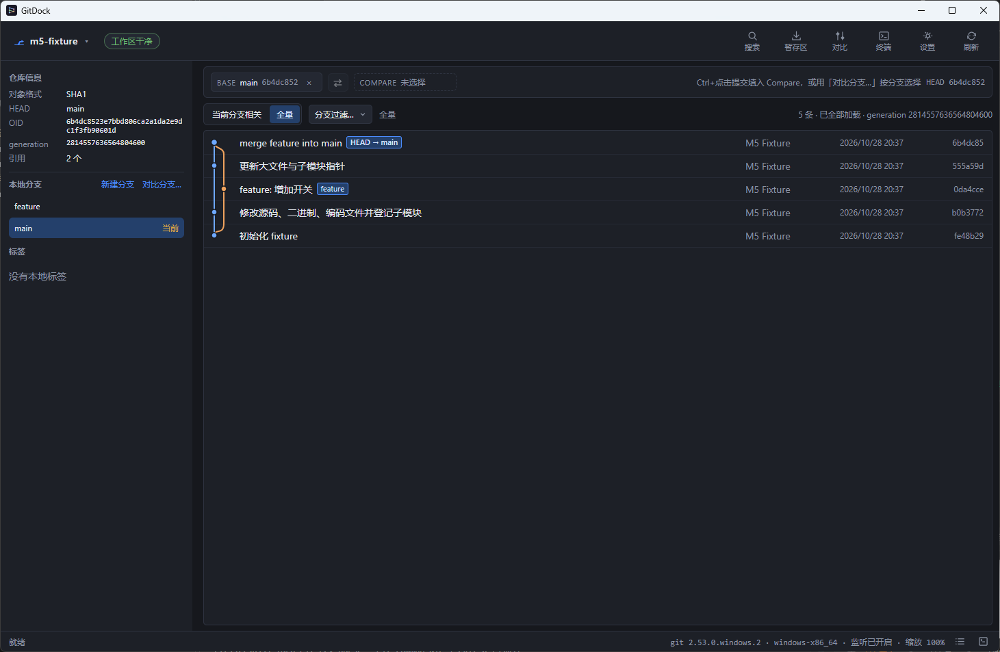

# GitDock

跨平台 Git 图谱桌面应用：查看提交历史与 diff，做多分支对比，也能在界面内完成常用 Git 操作。界面支持简体中文与 English。

## 产品展示

## 多分支对比

- 任选两个本地/远程分支或提交作为 Base 与 Compare
- 支持两点与三点 diff，三点模式自动定位 merge-base
- 展示 ahead/behind、文件级 diff、按路径过滤与语法高亮
- 图谱支持范围切换与分支过滤，选中提交即可定位

## Git 功能操作

- 提交：创建提交、amend；amend 有专门确认与 reflog 恢复说明
- 提交级操作：cherry-pick、revert；merge commit 可选择基线父提交
- 分支：切换、创建、重命名、安全删除；未合并分支的强制删除需到终端执行 `git branch -D`
- 标签：创建轻量/附注标签、删除本地标签
- stash：保存（可选包含未跟踪文件）、应用、弹出、删除；冲突时保留条目并进入冲突处理流程
- 写前检查：工作区不干净、存在未完成操作、名称冲突等情况会先拦截；删除、drop 等破坏性操作需专门确认

## 支持多平台

当前提供以下平台构建，可从 [Releases 页面](https://github.com/zyTheGit/gitdock/releases/latest) 下载：

| 平台                | 安装包                              | 状态                   |
| ------------------- | ----------------------------------- | ---------------------- |
| Windows 10/11 x64   | `.exe`（NSIS）                      | 主要支持               |
| Ubuntu 22.04 x86_64 | `.deb`（推荐）/ `.AppImage`（实验） | 已提供 CI 构建与安装包 |
| macOS Apple Silicon | `.dmg`                              | 未签名实验版           |

- Windows 安装包未做代码签名，首次运行 SmartScreen 可能提示；确认来源后点「更多信息」→「仍要运行」。
- Linux AppImage 需要系统安装 `libfuse2`；日常使用优先选择 `.deb`。
- macOS 未做签名/公证，首次打开需右键「打开」或执行 `xattr -cr`；正式支持状态以 Release 说明为准。
- 系统需安装 Git，建议 2.30 以上；版本更低时仍可浏览仓库，写操作会禁用。

## 支持中英文

界面支持简体中文与 English，可在「设置 → 外观 → 语言」切换，或选择跟随系统语言；切换即时生效。

## 更新与反馈

每次启动后自动检查一次更新，有新版本时状态栏右侧出现「更新」，点开是浏览器里的下载页；手动检查和「跳过此版本」在「设置 → 关于」。

问题和新需求请开 [Issue](https://github.com/zyTheGit/gitdock/issues)，应用内「设置 → 关于」也有反馈入口。

想从源码构建或参与开发，见 [开发者指南](docs/07-开发者指南.md)。