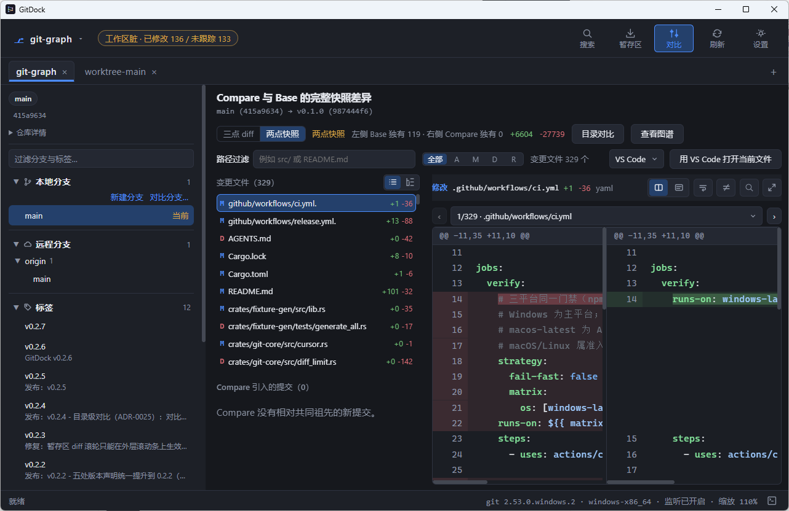

# GitDock

跨平台 Git 图谱桌面应用：查看提交历史与 diff，做多分支对比，也能在界面内完成常用 Git 操作。界面支持简体中文与 English。

## 产品展示

## 多分支对比

- 从分支对比弹窗任选两个引用，或在图谱中 `Ctrl/Cmd`+点击任意两个提交作为 Base 与 Compare
- 支持两点快照与三点 diff，三点模式自动定位 merge-base 并支持点击跳回图谱分叉点
- 提供**按提交 / 按文件**双视图、等价提交（cherry-pick）识别与隐藏、**两侧均改**撞车预警与一键筛选
- 支持调用外部对比工具进行单文件或完整目录级对比（如 Beyond Compare、VS Code 等）
- 图谱支持范围切换（当前分支 / 全量 / 指定分支）、极简节点悬浮卡与提交搜索（含作者日期区间）

## Git 功能操作

- 暂存与提交：文件级与 hunk 级暂存/取消暂存/丢弃、工作区改动丢弃、创建提交、amend 与提交模板预填
- 提交级操作：单条与批量 cherry-pick / revert、reset（soft/mixed/hard）与只读 Reflog 恢复视图；merge commit 可选基线父
- 分支与标签：切换、创建、重命名、安全删除本地/远程分支、远程跟踪分支检出、轻量/附注标签与描述管理
- Stash 与 Worktree：stash 保存/预览/工作区对比/应用/弹出/删除；worktree 列表、创建、安全移除与单仓库标签打开
- 远程同步与冲突：fetch（含 prune）、pull（仅快进/合并/变基）、push（含首推设上游与单标签推送）；Ours/Theirs/标记已解决与继续/中止，绝不自动 `--abort` / `--skip`

## 内置面板与工具

- 命令面板（`Ctrl/Cmd+Shift+P`）统一检索并执行高频操作，操作结果与恢复动作经统一通知队列反馈
- 底部多标签面板内置终端（LazyGit / Shell；Windows 支持在 Git Bash 与 PowerShell 间切换）与实时 Git 命令日志
- 面板支持高度拖拽与全屏切换，主题跟随系统浅/深/高对比度配色

## 支持平台与下载说明

> 当前**仅 Windows 10/11 x64 为正式支持目标**；Linux 与 macOS 处于未实机验收的实验构建阶段，功能清单待补齐原生实机验证。

| 平台                | 安装包                              | 状态                     |
| ------------------- | ----------------------------------- | ------------------------ |
| Windows 10/11 x64   | `.exe`（NSIS）                      | **主要正式支持**（未签名） |
| Ubuntu 22.04 x86_64 | `.deb`                              | 实验构建（未实机验收）   |
| macOS Apple Silicon | `.dmg`                              | 未签名实验构建           |

- Windows 安装包未做代码签名，首次运行 SmartScreen 可能提示；确认来源后点「更多信息」→「仍要运行」。
- Linux 仅提供 `.deb` 实验产物，需原生环境验证 WebKitGTK 运行时依赖。
- macOS 未做签名/公证，首次打开需右键「打开」或执行 `xattr -cr`。
- 系统需安装 Git，建议 2.30 以上；版本更低时仍可浏览仓库，写操作会禁用。

## 支持中英文

界面支持简体中文与 English，可在「设置 → 外观 → 语言」切换，或选择跟随系统语言；切换即时生效。

## 更新与反馈

每次启动后自动检查一次更新，有新版本时状态栏右侧出现「更新」，点开是浏览器里的下载页；手动检查和「跳过此版本」在「设置 → 关于」。

问题和新需求请开 [Issue](https://github.com/zyTheGit/gitdock/issues)，应用内「设置 → 关于」也有反馈入口。

想从源码构建或参与开发，见 [开发者指南](docs/07-开发者指南.md)。