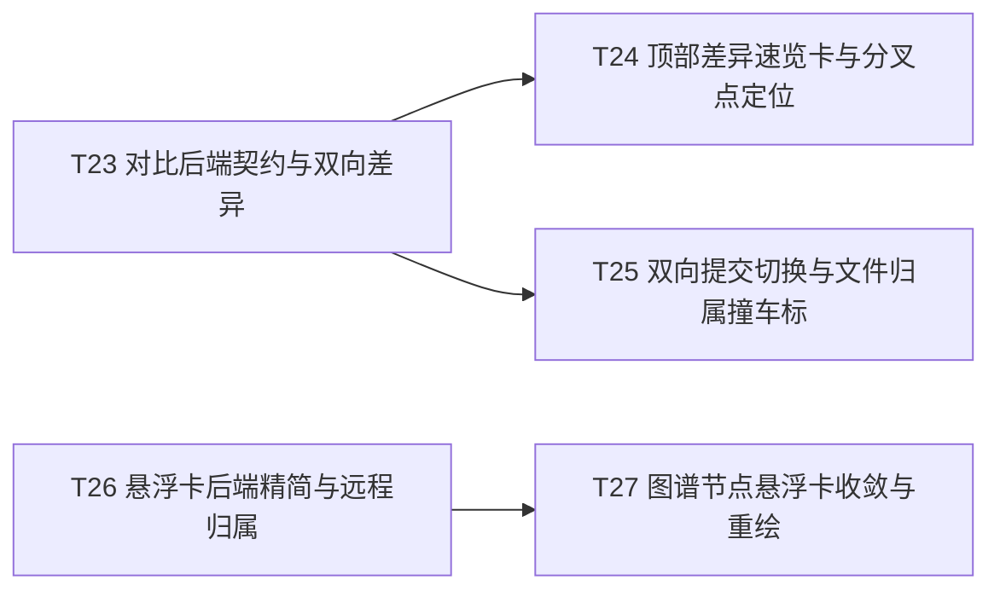

# 16 — 分支对比增强与节点悬浮卡精简任务拆分

- **对应 PRD**：[docs/15-分支对比增强与节点悬浮卡精简PRD.md](15-分支对比增强与节点悬浮卡精简PRD.md)
- **任务范围**：T23 ~ T27（一期闭环；二期图谱着色与提交-文件联动暂不立项）

---

## 1. 任务总览

| 编号 | 任务名称 | 波次 | 优先级 | 前置依赖 | 可并行关系 | 涉及层 | 文档 |
| :--- | :--- | :--- | :--- | :--- | :--- | :--- | :--- |
| **T23** | 分支对比后端契约与双向差异计算 | Wave A（底座） | P0 | 无 | ✅ 已完成 | `git-core` / `git-read` / `types.ts` / ADR | [T23](tasks/T23-分支对比后端契约与双向差异计算.md) |
| **T24** | 对比页顶部差异速览卡与分叉点定位 | Wave B（对比 UI） | P0 | T23 | ✅ 已完成 | `src/features/compare` / `i18n` / `styles` | [T24](tasks/T24-对比页顶部差异速览卡与分叉点定位.md) |
| **T25** | 对比页双向提交切换与文件归属撞车标 | Wave B（对比 UI） | P0 | T23 | ✅ 已完成 | `src/features/compare` / `i18n` / `styles` | [T25](tasks/T25-对比页双向提交切换与文件归属撞车标.md) |
| **T26** | 节点悬浮卡后端精简与远程分支归属 | Wave A（底座） | P1 | 无 | ✅ 已完成 | `git-core` / `git-read` / `types.ts` | [T26](tasks/T26-节点悬浮卡后端精简与远程分支归属.md) |
| **T27** | 图谱节点悬浮卡交互收敛与极简重绘 | Wave B（图谱 UI） | P1 | T26 | ✅ 已完成 | `src/features/graph` / `i18n` / `styles` | [T27](tasks/T27-图谱节点悬浮卡交互收敛与极简重绘.md) |
| **T28** | 对比页「按提交 / 按文件」双视图与原地详情 | Wave C（提交对比） | P0 | T25 | ✅ 已完成 | `src/features/compare` / `i18n` / `styles` | — |
| **T29** | Cherry-pick 等价提交识别与一键隐藏 | Wave C（提交对比） | P1 | T28 | ✅ 已完成 | `git-core` / `git-read` / `src/features/compare` | — |

---

## 2. 依赖与执行拓扑

- **推荐顺序**：
  1. 并行完成 **T23 + T26**（统一过一遍 DTO 契约与 Rust 单测，减少跨端返工）。
  2. 并行完成 **T24 + T25 + T27**（三条前端主线互不冲突）。
  3. 统一跑 `npm run check` 与实机 GUI 验收。

---

## 3. 全局硬约束

- **契约同步**：修改 `crates/git-core/src/dto/compare.rs` 时必须同步更新 `src/shared/types.ts`、[docs/03-技术架构.md](03-技术架构.md) 并在 `docs/adr/` 新增对应 ADR（T23、T26 合并或各自落一篇）。
- **文件行数**：所有新增文件控制在 `400` 行以内，触及的存量文件不超过 `600` 行（尤其注意 `src/styles/compare.css` 当前已 571 行，新增样式应拆出独立 CSS 或精简旧规则，确保不超 600 行）。
- **双语同步**：`src/i18n/locales/zh-CN/` 与 `en/` 保持 key 同构。
- **主题令牌**：所有新配色（如“两侧均改”徽章、双向比例条、泳道色边框）只使用 `src/styles/tokens.css` 语义令牌，不写死浅/深色值。
