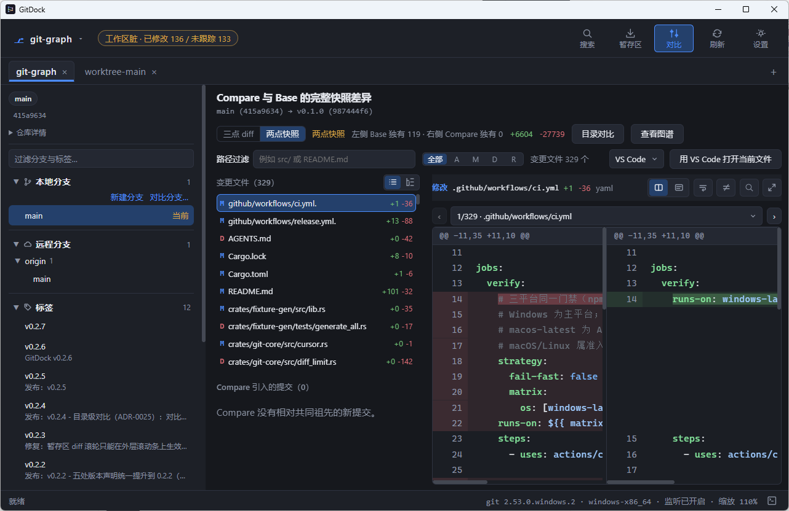

# 产品展示图维护说明

README 的产品展示图统一放在本目录，图片随仓库一起版本管理，不依赖外部图床。

## 当前清单（2026-11-26）

| 文件 | 状态 | 可追溯来源 | 当前用途 / 处理 |
|---|---|---|---|
| `compare-overview-01.png` | **当前有效（v0.2.8 基线）** | 随 `ae10fa9`（2026-11-20）纳入，`v0.2.8` = `356f352` | README「产品展示」主图；展示多标签、两点快照与并排 diff。可继续复用，不代表作者日期筛选或 T14–T22 已验收 |
| `graph-overview-02.png` | **当前有效（v0.2.8 基线）** | 随 `ae10fa9`（2026-11-20）纳入 | 多仓库标签与 Worktree 列表备选图；可用于架构/交接文档，路径已遮蔽 |
| `graph-overview-01.png` | **旧图（历史保留）** | `ef1e467`（2026-11-04） | 单仓库旧顶栏与旧侧栏样式；不得作为当前产品主图，不删除、不覆盖 |
| `diff-split-01.png` | **缺失** | 仅旧清单出现过，目录中无此文件 | 需要从当前 release 重拍并新增 |
| `staging-batch-01.png` | **缺失** | 仅旧清单出现过，目录中无此文件 | 需要从当前 release 重拍并新增 |
| `settings-gitconfig-01.png` | **缺失** | 仅旧清单出现过，目录中无此文件 | 需要从当前 release 重拍并新增 |

状态词固定为「当前有效」「旧图（历史保留）」「缺失」「待重拍」。只有取得当前 release 的截图、日期、环境与来源提交记录后，才能把新图标为「当前有效」；不得仅凭文件修改时间或旧文档引用判断。上表两张可复用图的**入库提交不等于截图制作时的精确构建、日期与环境**，目前没有完整 provenance，只能作为当前 UI 文档图复用，不能称为安装包 release 截图。

## 存放位置与命名

```text
docs/assets/screenshots/
  graph-overview-01.png          # 旧图，历史保留
  graph-overview-02.png          # 当前有效备选图
  compare-overview-01.png        # 当前 README 主图
  # 新增图使用 <视图>-<场景>-<序号>.png，不覆盖上表文件
```

- 使用小写 kebab-case：`<视图>-<场景>-<序号>.png`，例如 `compare-three-dot-01.png`、`terminal-lazygit-01.png`。
- 浅色/深色成对出现时追加主题：`graph-overview-dark-01.png`。
- 同一场景更新时递增序号，不覆盖历史图片；旧图保留并在本表标记状态。
- 仓库根目录 `README.md` 使用仓库根相对路径；本文件使用同目录相对路径，例如：

```md

```

## 图片要求

- UI 截图宽度建议 1200–1600 px，保持原始比例，不要拉伸。
- 优先 PNG；体积较大时可用 WebP。单张控制在 2 MB 以内。
- 动图仅在必须展示交互时使用，优先 WebP，GIF 不超过 5 MB。
- 截图内容避免出现令牌、密码、私有仓库地址、个人信息；仓库路径与作者信息需遮蔽。
- 每张图在 Markdown 中都要写有意义的 alt 文本。
- 截图只证明所展示界面在记录环境中可见，不替代 GUI 验收清单中的操作结果与仓库状态核对。

## 当前待拍清单

1. `staging-batch-01.png`：当前 release 的批量暂存/取消暂存与 hunk 操作。
2. `diff-split-01.png`：当前 release 的并排 diff、长行滚动与 diff 内搜索。
3. `settings-gitconfig-01.png`：当前 release 的 Git 配置用户级/项目级分区。
4. `search-author-date-01.png`：作者日期区间、草稿提示与结果摘要（ADR-0037，`9b1e371`）。
5. `worktree-create-01.png`：Worktree 创建对话框及**实际创建落盘**结果；未完成实机操作前只能标「待重拍」。
6. `terminal-panel-01.png`：当前 release 的终端/命令日志双标签与浅色主题。
7. T14–T22 的导航、CompareBar、命令面板等界面：实现并取得 release 证据后另增序号，不回用旧图冒充新界面。

每次重拍需记录：版本/tag、构建 commit、日期、OS/分辨率/缩放、主题、语言、夹具与操作步骤。记录写入本表后再更新 README 引用。

## 上传与版本控制

1. 把新图放到 `docs/assets/screenshots/`，使用新序号。
2. 更新本表的状态、来源与用途，再按需更新 README 引用。
3. 提交、打 tag 或推送只在用户明确要求时执行；不得为更新截图自动发布新版本。

GitHub 网页端拖入图片会生成 `user-images.githubusercontent.com` 外链，不属于仓库。需要长期稳定、可随版本归档时，应把图片下载后按上面的方式放入本目录。
